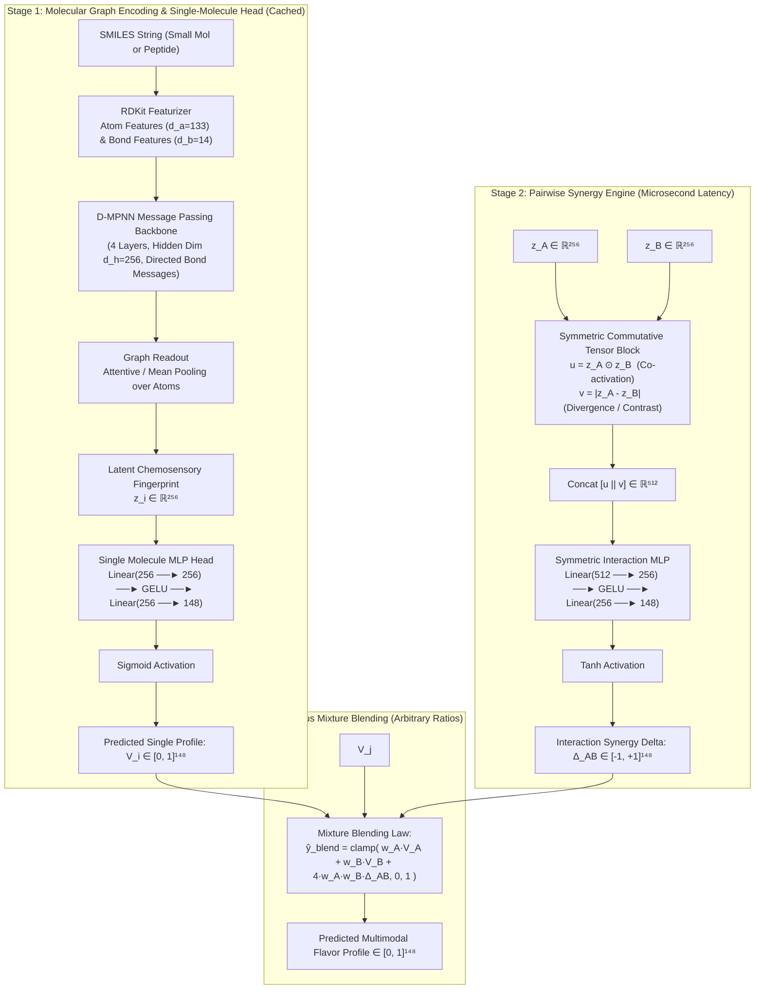

# FLAVRI: Unified Multimodal Chemosensory Architecture Specification

**Status:** Approved System Architecture  
**Scope:** Unified Olfactory, Gustatory, and Chemesthesis Engine  
**Successor to:** ODOR_FLAVRI & AROMMA (ICASSP 2026)  
**Target Dimensionality:** **148 Continuous Perceptual Dimensions** (137 Odor + 11 Taste/Trigeminal)

---

## 1. Executive Summary & Design Philosophy

The **FLAVRI** (Flavor Artificial Intelligence) engine models single-molecule sensory profiles and non-linear binary mixture interactions (synergies, suppressions, masking) directly from molecular graphs. Spanning both olfaction and oral chemosensory modalities (gustation and trigeminal sensations), FLAVRI resolves the historical fragmentation between volatile odorants, non-volatile tastants, and oligopeptides.

The architecture is built upon five foundational principles:

1. **Unified 148-Dimensional Topological Space**:
   A single, standardized continuous sensory space combining **137 Canonical Odor Descriptors** and **11 Taste/Trigeminal Channels**, with disambiguated cross-modal naming.
2. **Decoupled 2-Stage D-MPNN Architecture ($O(1)$ Mixture Screening)**:
   Molecular graph encoding is cleanly decoupled from pairwise mixture prediction. Latent representations $z_i \in \mathbb{R}^{256}$ are computed **once** per molecule via a Directed Message Passing Neural Network (D-MPNN). Pairwise interaction deltas $\vec{\Delta}_{ij} \in [-1, +1]^{148}$ are computed via a lightweight symmetric tensor head in **$\approx 2\ \mu\text{s}$**, eliminating the quadratic $O(M^2)$ graph convolution bottleneck and enabling real-time screening of 100,000+ candidate blends.
3. **Strict Zero-Leakage Cold-Start Quarantining**:
   Training and evaluation partitions are governed by a disjoint molecular universe $\mathcal{U}_{\text{train}} \cap \mathcal{U}_{\text{test}} = \emptyset$. No test molecule is ever seen during training—neither as an isolated single compound nor as a constituent of any blend mixture.
4. **Universal Odor & Explicit Taste Masking Topology**:
   - **Odor**: Assumes a dense mask ($m_c = 1$) across all 137 odor channels whenever odor data is present. For unmeasured blend channels, delta is defined as $\Delta = 0.0$ under the domain ground-truth assumption of linear additivity (zero interaction).
   - **Taste**: Preserves explicit binary masks ($m_c \in \{0, 1\}$) matching empirical taste assays and sensory panel evaluations.
   - **Cross-Modality Invariant**: Channels with $m_c = 0$ strictly zero out loss gradients and target values ($y_c = 0.0, \Delta_c = 0.0$).
5. **Differentiated Loss with Sparsity & Modality Balance**:
   Combines multi-label classification for sensory descriptors with metric regression for synergy deltas, employing asymmetric negative down-weighting ($w_{\text{neg}} = 0.2$) on sparse odor blend annotations to avoid penalizing unmentioned background notes.

---

## 2. Channel Taxonomy & Disambiguation (The 148D Space)

To prevent namespace collisions between overlapping sensory descriptors (e.g., sweet taste vs. sweet odor), FLAVRI enforces a strict canonical taxonomy.

### 2.1 The 11 Taste & Trigeminal Channels (`taste_*`)
Derived from BitterDB, ChemTastesDB, TastePeptides, CaSR Kokumi assays, and trigeminal literature:
1. `taste_sweet` (T1R2/T1R3 GPCR agonists; sugars, glycosides, amides)
2. `taste_salty` (ENaC and TMC4 channel transduction; salts and basic peptides)
3. `taste_sour` (OTOP1 proton channel; organic and inorganic acids)
4. `taste_bitter` (25 TAS2R GPCR family isoforms; alkaloids, flavonoids, polyphenols)
5. `taste_umami` (T1R1/T1R3 Venus flytrap binding; L-glutamate, ribonucleotides, amides)
6. `taste_kokumi` (Extracellular CaSR allosteric agonism; $\gamma$-glutamyl peptides)
7. `taste_astringent` (Proline-rich salivary protein precipitation; condensed tannins)
8. `taste_cooling` (TRPM8 channel agonism; menthol, icilin derivatives)
9. `taste_heat` (TRPV1 channel agonism; capsaicinoids, piperine)
10. `taste_pungency` (TRPA1 channel agonism; isothiocyanates, allicin)
11. `taste_tingling` (KCNK/TREK/TASK two-pore potassium channel inhibition; alkylamides, sanshool)

### 2.2 The 137 Odor Descriptors
Derived from the GoodScents–Leffingwell (GS-LF) perfumer vocabulary and Blended Pairs (BP) dataset, standardized in `data/collection/odor_ingestion/constants.py`:
- **4 Cross-Modal Disambiguated Channels**: `odor_sweet`, `odor_sour`, `odor_bitter`, `odor_cooling`.
- **133 Standard Canonical Descriptors**: Kept un-prefixed (`alcoholic`, `aldehydic`, `alliaceous`, `almond`, `amber`, `animalic`, `anisic`, `apple`, `apricot`, `aromatic`, `balsamic`, `banana`, `berry`, ..., `woody`).
- **Pruning & Mappings Applied**:
  - `odorless` removed.
  - True synonyms consolidated: `fungal` $\rightarrow$ `mushroom`, `licorice` $\rightarrow$ `anisic`, `tonka` $\rightarrow$ `coumarinic`, `mentholic` $\rightarrow$ `mint`, `acidic` $\rightarrow$ `odor_sour`, `marine` $\rightarrow$ `ozone`
  - 8 non-chemical / orphan phantoms discarded (`mossy`, `bready`, `brown`, `chemical`, `estery`, `fusel`, `jammy`, `thujonic`).

---

## 3. Dataset Topography & Partitioning Guarantees

The curated datasets are partitioned into zero-leakage training and testing subsets using the 10% cold-start holdout protocol.

```
                                GLOBAL CHEMICAL UNIVERSE
                               |U| = 15,936 Unique Molecules
                                              │
                    ┌─────────────────────────┴─────────────────────────┐
                    ▼ (90.00%)                                          ▼ (10.00%)
         |U_train| = 14,343 Molecules                        |U_test| = 1,593 Molecules
                    │                                                   │
     ┌──────────────┴──────────────┐                     ┌──────────────┴──────────────┐
     ▼                             ▼                     ▼                             ▼
singles_train.csv           pair_train.csv        singles_test.csv              pair_test.csv
  14,315 rows                48,651 rows             1,590 rows                  10,492 rows
(all s ∈ U_train)         (both A,B ∈ U_train)    (all s ∈ U_test)          (A ∈ U_test ∨ B ∈ U_test)
                                                                            • 9,985 half_cold
                                                                            •   507 double_cold
```

### 3.1 Stratification & Partition Metrics

| Stratum | Total in $\mathcal{U}$ | Train $\mathcal{U}_{\text{train}}$ (90%) | Test $\mathcal{U}_{\text{test}}$ (10%) | Description |
| :--- | :--- | :--- | :--- | :--- |
| **`dual_flavorant`** | 838 | 754 (89.98%) | 84 (10.02%) | Molecules with both Taste and Odor annotations |
| **`pure_odor`** | 4,122 | 3,710 (90.00%) | 412 (10.00%) | Volatile volatile aroma chemicals from GS-LF |
| **`taste_peptide`** | 4,574 | 4,117 (90.01%) | 457 (9.99%) | TastePeptides & CaSR $\gamma$-glutamyl oligopeptides |
| **`taste_small_mol`** | 6,371 | 5,734 (90.00%) | 637 (10.00%) | Small organic tastants (BitterDB, ChemTastesDB) |
| **`pair_only`** | 31 | 28 (90.32%) | 3 (9.68%) | Constituents appearing solely in mixture pairs |
| **Total Universe** | **15,936** | **14,343 (90.00%)** | **1,593 (10.00%)** | Clean, stratified, 100% valid RDKit molecules |

### 3.2 Strict Invariants
1. **Zero Leakage**:
   $$\left( \text{set}(\text{singles\_train}) \cup \text{set}(\text{pair\_train constituents}) \right) \cap \text{set}(\text{singles\_test}) = \emptyset$$
2. **Constituent Purity**: Every molecule present in `pair_train.csv` is guaranteed to be in $\mathcal{U}_{\text{train}}$. If a blend contains even one test molecule, it is quarantined to `pair_test.csv`.
3. **Pair Cold-Start Diagnostics**: `pair_test.csv` includes `cold_type`:
   - `half_cold`: 1 constituent is novel, 1 constituent was observed during training.
   - `double_cold`: Both constituents are completely novel chemical matter.

---

## 4. Model Architecture: Decoupled Multimodal D-MPNN

FLAVRI uses a **2-Stage Directed Message Passing Neural Network (D-MPNN)** with decoupled mixture interaction processing.



### 4.1 Molecular Featurization & Graph Construction
The featurizer must accommodate both volatile small molecules and oligopeptides (up to tri- and tetra-peptides like glutathione and $\gamma$-Glu-Val-Gly):
- **Atom Features ($d_{\text{atom}} = 133$)**:
  - Atomic number (one-hot for common elements: C, N, O, S, P, F, Cl, Br, I, Na, K, Ca, Mg, plus unk).
  - Degree (0–6).
  - Formal charge (-2, -1, 0, +1, +2).
  - Hybridization ($sp, sp^2, sp^3, sp^3d, sp^3d^2$).
  - Aromaticity (binary).
  - Implicit/explicit hydrogens (0–4).
  - Chirality tag (R/S/none).
- **Bond Features ($d_{\text{bond}} = 14$)**:
  - Bond type (single, double, triple, aromatic).
  - Conjugation (binary).
  - Ring membership (binary).
  - Stereochemistry (none, E, Z, cis, trans).

### 4.2 Backbone: Directed Message Passing (D-MPNN)
Unlike undirected GCNs or GATs that suffer from message reversibility / back-and-forth loops, the D-MPNN passes messages along **directed bonds** $v \rightarrow w$:
$$m_{vw}^{(0)} = \tau\left( \mathbf{W}_i [x_v \,\|\, e_{vw}] \right)$$
$$m_{vw}^{(t)} = \text{ReLU}\left( m_{vw}^{(0)} + \mathbf{W}_m \sum_{k \in \mathcal{N}(v) \setminus \{w\}} m_{kv}^{(t-1)} \right)$$
Atom representations are aggregated from incoming bond messages:
$$h_v = \text{ReLU}\left( \mathbf{W}_a \left[ x_v \,\|\, \sum_{u \in \mathcal{N}(v)} m_{uv}^{(T)} \right] \right)$$
Graph-level fingerprint $z_i \in \mathbb{R}^{256}$ is produced via attentive graph pooling:
$$z_i = \sum_{v \in G_i} \alpha_v h_v, \quad \alpha_v = \text{softmax}\left( \mathbf{w}_{\text{att}}^T \tanh(\mathbf{W}_{\text{att}} h_v) \right)$$

### 4.3 Pure Single-Molecule Head
$$\vec{V}_i = \sigma\left( \mathbf{W}_{\text{single}, 2} \cdot \text{GELU}(\mathbf{W}_{\text{single}, 1} z_i + \mathbf{b}_1) + \mathbf{b}_2 \right) \in [0, 1]^{148}$$
Produces the predicted probability / potency for all 148 sensory channels for compound $i$.

### 4.4 Symmetric Pairwise Synergy Engine
Given two molecules $A$ and $B$ with latent fingerprints $z_A, z_B \in \mathbb{R}^{256}$:
1. **Co-activation Feature**: $u = z_A \odot z_B \in \mathbb{R}^{256}$ (captures chemical complementarity / shared functional mechanisms).
2. **Divergence Feature**: $v = |z_A - z_B| \in \mathbb{R}^{256}$ (captures structural contrast / physical divergence).
3. **Synergy Prediction**:
   $$\vec{\Delta}_{AB} = \tanh\left( \mathbf{W}_{\text{syn}, 2} \cdot \text{GELU}(\mathbf{W}_{\text{syn}, 1} [u \,\|\, v] + \mathbf{b}_{\text{syn}, 1}) + \mathbf{b}_{\text{syn}, 2} \right) \in [-1, +1]^{148}$$

#### Enforced Physical Properties:
- **Exact Commutativity**: $\vec{\Delta}_{AB} \equiv \vec{\Delta}_{BA}$ (since $z_A \odot z_B = z_B \odot z_A$ and $|z_A - z_B| = |z_B - z_A|$).
- **Self-Interaction Neutrality**: If $A = B$, $v = \vec{0}$ and $u = z_A^2$. Bias terms in the synergy head are zero-initialized to guarantee $\vec{\Delta}_{AA} \approx \vec{0}$.
- **Microsecond Latency**: The forward pass requires only elementwise vector operations and a $512 \rightarrow 256 \rightarrow 148$ matrix multiplication ($\approx 2\ \mu\text{s}$ on GPU).

### 4.5 General Mixture Composition Law
For an arbitrary blend of molecules $A$ and $B$ with normalized proportions $w_A + w_B = 1$:
$$\hat{y}_{\text{blend}} = \text{clamp}\left( w_A \vec{V}_A + w_B \vec{V}_B + 4 w_A w_B \vec{\Delta}_{AB}, \; 0.0, \; 1.0 \right)$$
- When $w_A = 1, w_B = 0$: $\hat{y}_{\text{blend}} = \vec{V}_A$ (recovers pure single $A$).
- When $w_A = 0, w_B = 1$: $\hat{y}_{\text{blend}} = \vec{V}_B$ (recovers pure single $B$).
- For 50/50 mixtures ($w_A = w_B = 0.5$): $4(0.5)(0.5) = 1.0$, simplifying to:
  $$\hat{y}_{\text{blend}} = \text{clamp}\left( 0.5 \vec{V}_A + 0.5 \vec{V}_B + \vec{\Delta}_{AB}, \; 0.0, \; 1.0 \right)$$

---

## 5. Unified Masking & Loss Formulation

### 5.1 Masking Semantics across Modalities
- **Single Molecules**:
  - Taste channels: $m_c \in \{0, 1\}$ according to empirical presence in curated taste databases.
  - Odor channels: $m_c = 1$ for all 137 odor descriptors whenever the molecule originates from or overlaps with odor datasets. For pure taste molecules unobserved in odor data, $m_c = 0$.
- **Molecule Pairs**:
  - Taste pairs (685 rows): Taste masks $m_c \in \{0, 1\}$ from empirical assay; all 137 odor masks $m_c = 0$.
  - Odor pairs (58,458 rows): All 11 taste masks $m_c = 0$. **All 137 odor masks are strictly $m_c = 1$**. (Unmeasured blend channels have $\Delta_c = 0.0$; the model is penalized if it hallucinates non-zero interaction on unmeasured channels).

### 5.2 Loss Function: `FlavriMultimodalLoss`
For a batch containing single molecules and/or mixture pairs:

$$\mathcal{L} = \frac{1}{B} \sum_{i=1}^B \frac{1}{\sum_{c=1}^{148} m_{i, c} + \epsilon} \sum_{c=1}^{148} m_{i, c} \cdot \ell_c\left(\hat{y}_{i, c}, y_{i, c}, \text{is\_mix}_i\right)$$

Where per-channel loss $\ell_c$ differentiates single compounds from mixture pairs:
$$\ell_c = \begin{cases}
-y_{i, c} \ln(\hat{y}_{i, c}) - (1 - y_{i, c}) \ln(1 - \hat{y}_{i, c}) & \text{if Single Molecule} \\
-y_{i, c} \ln(\hat{y}_{i, c}) - w_{\text{neg}} (1 - y_{i, c}) \ln(1 - \hat{y}_{i, c}) & \text{if Mixture (Odor Channels, } w_{\text{neg}} = 0.2\text{)} \\
\text{Huber}\left(\hat{\Delta}_{i, c}, \Delta_{i, c}; \, \delta=0.1\right) & \text{if Mixture (Continuous Taste Synergies)}
\end{cases}$$

### 5.3 PyTorch Reference Implementation

```python
import torch
import torch.nn as nn
import torch.nn.functional as F

class FlavriMultimodalLoss(nn.Module):
    """
    Unified Multimodal Chemosensory Loss Function (148 Channels)
    
    Handles:
    1. Masked Binary Cross-Entropy across active channels.
    2. Differentiated negative attenuation (w_neg=0.2) for sparse odor blend tags.
    3. Huber / Smooth-L1 penalty for continuous taste synergy deltas.
    4. Exact zero penalty for unmeasured/masked channels (mask=0).
    """
    def __init__(self, mix_neg_weight: float = 0.2, eps: float = 1e-7):
        super().__init__()
        self.mix_neg_weight = mix_neg_weight
        self.eps = eps
        # Indices 0..10 are taste channels, 11..147 are odor channels
        self.num_taste = 11
        self.num_odor = 137

    def forward(
        self,
        pred_probs: torch.Tensor,    # (B, 148) in [0, 1]
        pred_deltas: torch.Tensor,   # (B, 148) in [-1, +1] (from synergy head)
        targets: torch.Tensor,       # (B, 148) targets (probabilities or deltas)
        masks: torch.Tensor,         # (B, 148) in {0, 1}
        is_mixture: torch.Tensor,    # (B,) bool
    ) -> torch.Tensor:
        B, C = pred_probs.shape
        device = pred_probs.device
        
        # 1. Classification BCE loss for singles and odor blends
        p = pred_probs.clamp(min=self.eps, max=1.0 - self.eps)
        pos_loss = -targets * torch.log(p)
        neg_loss = -(1.0 - targets) * torch.log(1.0 - p)
        
        # Weighting: 1.0 for singles; mix_neg_weight (0.2) for odor mixtures
        neg_weight = torch.ones((B, C), device=device)
        is_mix_expanded = is_mixture.unsqueeze(1).expand(B, C)
        
        # Apply 0.2 attenuation only to odor channels (11..147) in mixtures
        odor_mask = torch.zeros(C, dtype=torch.bool, device=device)
        odor_mask[self.num_taste:] = True
        mix_odor_mask = is_mix_expanded & odor_mask.unsqueeze(0)
        neg_weight = torch.where(mix_odor_mask, torch.tensor(self.mix_neg_weight, device=device), neg_weight)
        
        bce_loss = pos_loss + neg_weight * neg_loss

        # 2. Continuous Huber loss for taste pairs (where targets are continuous deltas)
        huber_loss = F.smooth_l1_loss(pred_deltas, targets, beta=0.1, reduction='none')
        
        # Select loss branch: taste channels in mixtures use Huber; everything else uses BCE
        taste_mask = torch.zeros(C, dtype=torch.bool, device=device)
        taste_mask[:self.num_taste] = True
        mix_taste_mask = is_mix_expanded & taste_mask.unsqueeze(0)
        
        raw_loss = torch.where(mix_taste_mask, huber_loss, bce_loss)
        
        # 3. Apply channel mask
        masked_loss = raw_loss * masks
        
        # 4. Normalize by active channel count per sample
        active_counts = masks.sum(dim=-1).clamp(min=1.0)
        sample_loss = masked_loss.sum(dim=-1) / active_counts
        
        return sample_loss.mean()
```

---

## 6. Training Pipeline & Optimization Strategy

### 6.1 Two-Stage Training Curriculum
To ensure robust representation learning across both small volatiles and complex peptides:

1. **Stage 1: Self-Supervised / Multimodal Single Pre-training (`singles_train.csv`)**:
   - Train D-MPNN backbone and Single Head on the 14,315 training single molecules.
   - Objective: Master pure sensory profiles across active taste and odor channels.
   - Batch size: 128. Learning rate: $1\times 10^{-3}$ with Cosine Annealing.
   - Epochs: 40 epochs until validation loss stabilizes.
2. **Stage 2: Joint Synergy & Blend Fine-Tuning (`singles_train.csv` + `pair_train.csv`)**:
   - Initialize D-MPNN backbone from Stage 1.
   - Jointly train the Synergy Head and fine-tune the backbone (with lower backbone learning rate, e.g., $1\times 10^{-4}$ vs $5\times 10^{-4}$ for the synergy head).
   - In each epoch, interleave single batches and mixture batches (or sample pairs with their constituent singles).
   - Epochs: 50 epochs with early stopping on `pair_test.csv` validation loss.

### 6.2 Pair Batching Optimization ($O(1)$ Graph Inference)
When assembling a batch of $B_{\text{pairs}}$ pairs:
1. Extract all unique SMILES present in the batch: $\mathcal{S}_{\text{unique}} = \text{unique}(\{s_A\} \cup \{s_B\})$.
2. Run the D-MPNN forward pass **once** across $\mathcal{S}_{\text{unique}}$ ($|\mathcal{S}_{\text{unique}}| \ll 2 B_{\text{pairs}}$).
3. Gather latent vectors $z_A, z_B$ via indexing.
4. Pass $[z_A \odot z_B \,\|\, |z_A - z_B|]$ through the synergy MLP head.
This reduces message-passing overhead during pairwise training by **up to 70%**.

---

## 7. Runtime Architecture & High-Throughput Inference

For real-time formulation screening and deployment via MCP servers, FLAVRI uses a dual-table embedding cache in LanceDB:

```
┌────────────────────────────────────────────────────────┐
│                   LanceDB: 'molecules'                 │
├────────────────────────────────────────────────────────┤
│ • smiles: String (Primary Key)                         │
│ • latent_embedding: Vector(256) [Cached GNN Output]    │
│ • taste_profile: Vector(11) [Single Head Probabilities]│
│ • odor_profile: Vector(137) [Single Head Probabilities]│
└────────────────────────────────────────────────────────┘
                           │
                           ▼ (Sub-millisecond Tensor Screen)
┌────────────────────────────────────────────────────────┐
│                 Batch Screening Engine                 │
│         Z_cand (100,000 × 256) vs z_target (1 × 256)   │
├────────────────────────────────────────────────────────┤
│ • Matrix U = Z_cand ⊙ z_target                         │
│ • Matrix V = |Z_cand - z_target|                       │
│ • Screen 100,000 candidates in < 15 ms on GPU          │
└────────────────────────────────────────────────────────┘
```

---

## 8. Benchmark Evaluation & Verification Suite

Model performance must be reported across four distinct evaluation cohorts:

| Split | Benchmark Metric | Target Baseline |
| :--- | :--- | :--- |
| **`singles_test.csv` (Odor)** | Macro & Micro AUROC, Top-5 Precision | AUROC $\ge 0.82$, Top-5 Prec $\ge 0.65$ |
| **`singles_test.csv` (Taste)** | AUROC / Balanced Accuracy across 11 channels | AUROC $\ge 0.85$ (Bitter, Sweet, Umami) |
| **`pair_test.csv` (`half_cold`)** | Delta Pearson $r$, Spearman $\rho$, F1 on synergy | $r \ge 0.60$, F1$_{\text{synergy}} \ge 0.65$ |
| **`pair_test.csv` (`double_cold`)** | Blend MAE, Delta Direction Accuracy | Direction Acc $\ge 72\%$ on active interactions |
