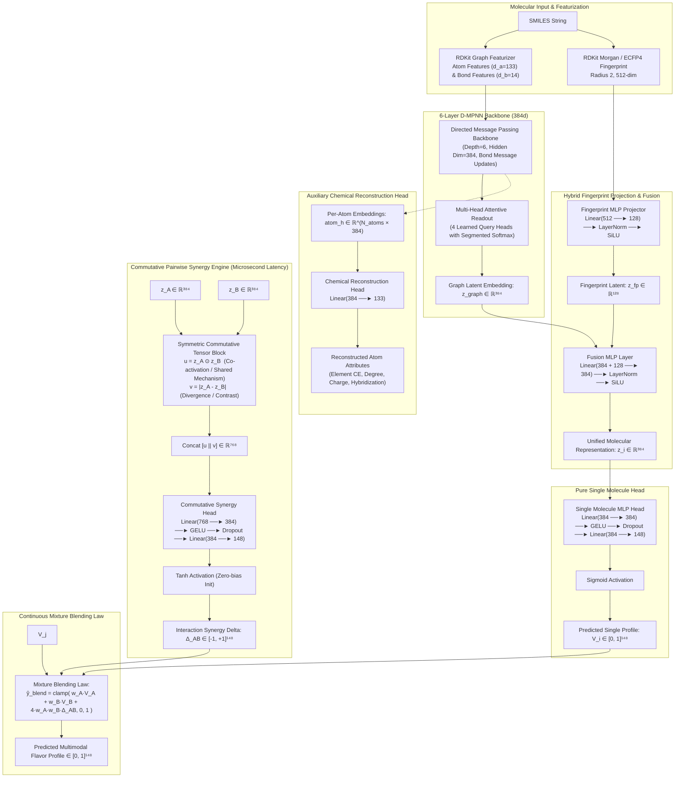

# FLAVRI: Unified Multimodal Chemosensory Architecture Specification

**Scope:** Unified Olfactory, Gustatory, and Chemesthesis Engine  
**Successor to:** ODOR_FLAVRI & AROMMA (ICASSP 2026)  
**Target Dimensionality:** **148 Continuous Perceptual Dimensions** (137 Odor + 11 Taste/Trigeminal)  
**Active Architecture Version:** 512d, 6-Layer D-MPNN with 4-Head Attentive Readout, Hybrid Fingerprint Fusion, Persistent Chemical Auxiliary Head, PCGrad Multi-Task Optimization, Continuous Huber Odor Delta Regression, and Stage 3 SWA Polishing

---

## 1. Executive Summary & Design Philosophy

The **FLAVRI** (Flavor Artificial Intelligence) engine models single-molecule sensory profiles and non-linear binary mixture interactions (synergies, suppressions, masking) directly from molecular graphs. Spanning both olfaction and oral chemosensory modalities (gustation and trigeminal sensations), FLAVRI resolves the historical fragmentation between volatile odorants, non-volatile tastants, and oligopeptides.

The architecture is built upon six foundational principles:

1. **Unified 148-Dimensional Topological Space**:
   A single, standardized continuous sensory space combining **137 Canonical Odor Descriptors** and **11 Taste/Trigeminal Channels**, with disambiguated cross-modal naming.
2. **Decoupled Multimodal D-MPNN Architecture ($O(1)$ Mixture Screening)**:
   Molecular graph encoding is cleanly decoupled from pairwise mixture prediction. Latent representations $z_i \in \mathbb{R}^{384}$ are computed **once** per molecule via a 6-layer Directed Message Passing Neural Network (D-MPNN) combined with hybrid Morgan fingerprint fusion. Pairwise interaction deltas $\vec{\Delta}_{ij} \in [-1, +1]^{148}$ are computed via a lightweight symmetric commutative tensor head in **$\approx 2\ \mu\text{s}$**, eliminating the quadratic $O(M^2)$ graph convolution bottleneck and enabling real-time screening of 100,000+ candidate blends.
3. **Four-Stage Training Curriculum with Post-Training SWA Flat-Basin Discovery**:
   - **Stage 0**: Self-supervised chemical foundation pre-training (500k MOSES molecules) via masked heteroatom attribute reconstruction.
   - **Stage 1**: Supervised sensory anchoring with cyclical warm restarts (`CosineAnnealingWarmRestarts`), Plackett-Luce ranking, and persistent chemical regularization.
   - **Stage 2**: Joint multi-task mixture synergy and singles anchoring optimized with **PCGrad** (Projecting Conflicting Gradients) and direct continuous Huber loss on odor deltas.
   - **Stage 3**: Stochastic Weight Averaging (SWA) flat-basin discovery saved to a dedicated `checkpoints/stage3/` directory.
4. **Strict Zero-Leakage Cold-Start Quarantining**:
   Training and evaluation partitions are governed by a disjoint molecular universe $\mathcal{U}_{\text{train}} \cap \mathcal{U}_{\text{test}} = \emptyset$. No test molecule is ever seen during training—neither as an isolated single compound nor as a constituent of any blend mixture.
5. **Universal Odor & Explicit Taste Masking Topology with Negative Anchoring**:
   - **Odor**: Dense mask ($m_c = 1$) across all 137 odor channels whenever odor data is present. For unmeasured blend channels, delta is defined as $\Delta = 0.0$ under the domain ground-truth assumption of linear additivity.
   - **Taste**: Preserves explicit binary masks ($m_c \in \{0, 1\}$) matching empirical taste assays, expanded in FLAVRI 0.5 with thousands of confirmed non-bitter / tasteless negative tastants to eliminate positive-frequency baseline drift.
   - **Cross-Modality Invariant**: Channels with $m_c = 0$ strictly zero out loss gradients and target values ($y_c = 0.0, \Delta_c = 0.0$).
6. **Differentiated Multi-Task Loss with Continuous Huber Regression**:
   Combines calibrated focal binary cross-entropy, Plackett-Luce listwise ranking, and continuous Huber regression on both taste and odor synergy deltas to ensure accurate linear slope correlation (Pearson $r$) and direction agreement.

---

## 2. Channel Taxonomy & Disambiguation (The 148D Space)

To prevent namespace collisions between overlapping sensory descriptors (e.g., sweet taste vs. sweet odor), FLAVRI enforces a strict canonical taxonomy.

### 2.1 The 11 Taste & Trigeminal Channels (`taste_*`)
Derived from BitterDB, ChemTastesDB, TastePeptides, CaSR Kokumi assays, and trigeminal literature:
1. `taste_sweet` (T1R2/T1R3 GPCR agonists; sugars, glycosides, amides)
2. `taste_salty` (ENaC and TMC4 channel transduction; salts and basic peptides)
3. `taste_sour` (OTOP1 proton channel; organic and inorganic acids)
4. `taste_bitter` (25 TAS2R GPCR family isoforms; alkaloids, flavonoids, polyphenols)
5. `taste_umami` (T1R1/T1R3 Venus flytrap binding; L-glutamate, ribonucleotides, amides)
6. `taste_kokumi` (Extracellular CaSR allosteric agonism; $\gamma$-glutamyl peptides)
7. `taste_astringent` (Proline-rich salivary protein precipitation; condensed tannins)
8. `taste_cooling` (TRPM8 channel agonism; menthol, icilin derivatives)
9. `taste_heat` (TRPV1 channel agonism; capsaicinoids, piperine)
10. `taste_pungency` (TRPA1 channel agonism; isothiocyanates, allicin)
11. `taste_tingling` (KCNK/TREK/TASK two-pore potassium channel inhibition; alkylamides, sanshool)

### 2.2 The 137 Odor Descriptors
Derived from the GoodScents–Leffingwell (GS-LF) perfumer vocabulary and Blended Pairs (BP) dataset, standardized in `data/collection/odor_ingestion/constants.py`:
- **4 Cross-Modal Disambiguated Channels**: `odor_sweet`, `odor_sour`, `odor_bitter`, `odor_cooling`.
- **133 Standard Canonical Descriptors**: Kept un-prefixed (`alcoholic`, `aldehydic`, `alliaceous`, `almond`, `amber`, `animal`, `anisic`, `apple`, `apricot`, `aromatic`, `balsamic`, `banana`, `berry`, ..., `woody`).
- **Pruning & Mappings Applied**:
  - `odorless` removed.
  - True synonyms consolidated: `fungal` $\rightarrow$ `mushroom`, `licorice` $\rightarrow$ `anisic`, `tonka` $\rightarrow$ `coumarinic`, `mentholic` $\rightarrow$ `mint`, `acidic` $\rightarrow$ `odor_sour`, `marine` $\rightarrow$ `ozone`.
  - Non-chemical / orphan phantoms discarded (`mossy`, `bready`, `brown`, `chemical`, `estery`, `fusel`, `jammy`, `thujonic`).

---

## 3. Dataset Topography & Partitioning Guarantees

The curated datasets are partitioned into zero-leakage training and testing subsets using the 10% cold-start holdout protocol. In FLAVRI 0.5, the single molecule dataset was expanded to incorporate thousands of confirmed negative / tasteless samples from public assays (e.g. `bn_train`, `N6512`).

```
                                GLOBAL CHEMICAL UNIVERSE
                               |U| = 25,701 Unique Molecules
                                              │
                    ┌─────────────────────────┴─────────────────────────┐
                    ▼ (90.00%)                                          ▼ (10.00%)
         |U_train| = 23,131 Molecules                        |U_test| = 2,570 Molecules
                    │                                                   │
     ┌──────────────┴──────────────┐                     ┌──────────────┴──────────────┐
     ▼                             ▼                     ▼                             ▼
singles_train.csv           pair_train.csv        singles_test.csv              pair_test.csv
  23,131 rows                48,651 rows             2,570 rows                  11,037 rows
(all s ∈ U_train)         (both A,B ∈ U_train)    (all s ∈ U_test)          (A ∈ U_test ∨ B ∈ U_test)
                                                                            • 10,441 half_cold
                                                                            •    596 double_cold
```

### 3.1 Strict Invariants
1. **Zero Leakage**:
   $$\left( \text{set}(\text{singles\_train}) \cup \text{set}(\text{pair\_train constituents}) \right) \cap \text{set}(\text{singles\_test}) = \emptyset$$
2. **Constituent Purity**: Every molecule present in `pair_train.csv` is guaranteed to be in $\mathcal{U}_{\text{train}}$. If a blend contains even one test molecule, it is quarantined to `pair_test.csv`.
3. **Pair Cold-Start Diagnostics**: `pair_test.csv` includes `cold_type`:
   - `half_cold`: 1 constituent is novel to the model, 1 constituent was observed during training.
   - `double_cold`: Both constituents are completely novel chemical matter.

---

## 4. Model Architecture: Decoupled Multimodal D-MPNN (FLAVRI 2.0)

FLAVRI 2.0 scales the model capacity to **2.1 Million parameters** with 6 message-passing layers and 384 hidden dimensions, multi-head attentive readout, hybrid fingerprint conditioning, and persistent chemical reconstruction.



### 4.1 Molecular Featurization
- **Atom Features ($d_{\text{atom}} = 133$)**:
  - Atomic number (one-hot across 101 elements).
  - Degree (0–6).
  - Formal charge (-2, -1, 0, +1, +2, other).
  - Number of radical electrons.
  - Hybridization ($sp, sp^2, sp^3, sp^3d, sp^3d^2$, other).
  - Aromaticity (binary flag).
  - Total hydrogens (0–4).
  - Chirality tag (R/S/none).
- **Bond Features ($d_{\text{bond}} = 14$)**:
  - Bond type (single, double, triple, aromatic).
  - Conjugation (binary).
  - Ring membership (binary).
  - Stereochemistry (none, E, Z, cis, trans).

### 4.2 Backbone: 6-Layer D-MPNN with 4-Head Attentive Readout
Initial directed bond messages:
$$m_{vw}^{(0)} = \text{ReLU}\left( \mathbf{W}_i [x_v \,\|\, e_{vw}] \right), \quad \mathbf{W}_i \in \mathbb{R}^{384 \times (133 + 14)}$$
Directed message updates for $t = 1, \dots, 5$:
$$m_{vw}^{(t)} = \text{ReLU}\left( m_{vw}^{(0)} + \mathbf{W}_m \sum_{k \in \mathcal{N}(v) \setminus \{w\}} m_{kv}^{(t-1)} \right), \quad \mathbf{W}_m \in \mathbb{R}^{384 \times 384}$$
Atom representation aggregation:
$$h_v = \text{ReLU}\left( \mathbf{W}_a \left[ x_v \,\|\, \sum_{u \in \mathcal{N}(v)} m_{uv}^{(T)} \right] \right), \quad \mathbf{W}_a \in \mathbb{R}^{384 \times (133 + 384)}$$

#### Multi-Head Attentive Readout Pooling (4 Heads)
Instead of simple mean or single-attention pooling, FLAVRI 2.0 uses $K=4$ query heads to attend to distinct structural motifs:
$$S_{v, k} = \mathbf{v}_{\text{att}, k}^T \tanh(\mathbf{W}_{\text{att}} h_v), \quad \alpha_{v, k} = \text{softmax}_{v \in G_i}(S_{v, k})$$
$$z_{\text{graph}, k} = \sum_{v \in G_i} \alpha_{v, k} h_v$$
$$z_{\text{graph}} = \text{SiLU}\left( \text{LayerNorm}\left( \mathbf{W}_{\text{proj}} [z_{\text{graph}, 1} \,\|\, \dots \,\|\, z_{\text{graph}, K}] \right) \right) \in \mathbb{R}^{384}$$

### 4.3 Hybrid Fingerprint Fusion
To complement topological graph message passing with global substructure hashing:
$$z_{\text{fp}} = \text{SiLU}\left( \text{LayerNorm}\left( \mathbf{W}_{\text{fp}} \text{ECFP4}(m) \right) \right) \in \mathbb{R}^{128}$$
$$z_{\text{final}} = \text{SiLU}\left( \text{LayerNorm}\left( \mathbf{W}_{\text{fuse}} [z_{\text{graph}} \,\|\, z_{\text{fp}}] \right) \right) \in \mathbb{R}^{384}$$

### 4.4 Auxiliary Chemical Reconstruction Head
Trained during Stage 0 and retained as a persistent chemical anchor in Stages 1 and 2:
$$\hat{x}_v = \mathbf{W}_{\text{chem}, 2} \cdot \text{GELU}(\mathbf{W}_{\text{chem}, 1} h_v) \in \mathbb{R}^{133}$$

### 4.5 Commutative Pairwise Synergy Engine
Given $z_A, z_B \in \mathbb{R}^{384}$:
1. **Co-activation**: $u = z_A \odot z_B \in \mathbb{R}^{384}$
2. **Divergence**: $v = |z_A - z_B| \in \mathbb{R}^{384}$
3. **Synergy Prediction**:
   $$\vec{\Delta}_{AB} = \tanh\left( \mathbf{W}_{\text{syn}, 2} \cdot \text{GELU}(\mathbf{W}_{\text{syn}, 1} [u \,\|\, v] + \mathbf{b}_{\text{syn}, 1}) \right) \in [-1, +1]^{148}$$

#### Enforced Invariants:
- **Exact Commutativity**: $\vec{\Delta}_{AB} \equiv \vec{\Delta}_{BA}$ by algebraic symmetry.
- **Identity Neutrality**: If $A = B$, $v = \vec{0}$ and $u = z_A^2$. Bias terms in the output projection are strictly zero-initialized, and an explicit identity penalty $\mathcal{L}_{\text{id}} = \frac{1}{B} \sum_i \|\vec{\Delta}_{ii}\|_2^2$ is enforced during training.
- **Microsecond Latency**: Forward pass takes $\approx 2\ \mu\text{s}$ on GPU, enabling screening 100,000 candidate pairings in $<15\ \text{ms}$.

### 4.6 Continuous Mixture Blending Law
For an arbitrary blend with proportions $w_A + w_B = 1$:
$$\hat{y}_{\text{blend}} = \text{clamp}\left( w_A \vec{V}_A + w_B \vec{V}_B + 4 w_A w_B \vec{\Delta}_{AB}, \; 0.0, \; 1.0 \right)$$
For 50/50 mixtures ($w_A = w_B = 0.5$):
$$\hat{y}_{\text{blend}} = \text{clamp}\left( 0.5 \vec{V}_A + 0.5 \vec{V}_B + \vec{\Delta}_{AB}, \; 0.0, \; 1.0 \right)$$

---

## 5. Loss Formulation & Multi-Task Objectives

### 5.1 Single Molecule Loss (`FlavriSinglesLoss`)
$$\mathcal{L}_{\text{singles}} = \mathcal{L}_{\text{calib}} + \lambda_{\text{rank}} \mathcal{L}_{\text{rank}} + \lambda_{\text{hier}} \mathcal{L}_{\text{hier}} + \lambda_{\text{antag}} \mathcal{L}_{\text{antag}}$$

1. **Class-Balanced Focal Loss**:
   $$\mathcal{L}_{\text{calib}} = -\sum_{c} m_c \left[ y_c (1 - p_c)^\gamma \ln(p_c) + (1 - y_c) p_c^\gamma \ln(1 - p_c) \right]$$
2. **Plackett-Luce Listwise Ranking Loss**:
   Treats positive odor annotations as a probability distribution over scent dominance:
   $$\mathcal{L}_{\text{rank}} = -\sum_{c \in \text{odor}} P_{\text{true}}(c) \cdot \ln\left( \frac{\exp(s_c / \tau)}{\sum_k \exp(s_k / \tau)} \right)$$
3. **Data-Driven Hierarchy & Antagonism Constraints**:
   $$\mathcal{L}_{\text{hier}} = \frac{1}{|E_{\text{hier}}|} \sum_{(p, c) \in E_{\text{hier}}} \max(0, p_c - p_p)^2$$
   $$\mathcal{L}_{\text{antag}} = \frac{1}{2} \vec{p}_{\text{odor}}^T \mathbf{A}_{\text{antag}} \vec{p}_{\text{odor}}$$

### 5.2 Mixture & Synergy Loss (`FlavriMultimodalLoss`)
To guarantee linear correlation (Pearson $r$) and magnitude ranking on blends:
$$\mathcal{L}_{\text{mix}} = \frac{1}{\sum m_c} \sum_{c=1}^{148} m_c \cdot \ell_c$$
$$\ell_c = \begin{cases}
\text{Huber}(\hat{\Delta}_c, \Delta_c; \beta=0.1) & \text{if Taste Mixture Channel} \\
\text{BCE}_{\text{blend}}(p_c, y_{\text{blend}, c}) + \lambda_{\Delta} \text{Huber}(\hat{\Delta}_c, \Delta_c; \beta=0.1) & \text{if Odor Mixture Channel}
\end{cases}$$

### 5.3 Chemical Reconstruction Loss (`ChemicalReconstructionLoss`)
Heteroatom-reweighted multi-task cross-entropy across masked atoms:
$$\mathcal{L}_{\text{chem}} = \text{CE}(x_{\text{elem}}, \hat{x}_{\text{elem}}; w_{\text{elem}}) + 0.3 \left( \mathcal{L}_{\text{degree}} + \mathcal{L}_{\text{charge}} + \mathcal{L}_{\text{hybrid}} + \mathcal{L}_{\text{arom}} \right)$$
where $w_{\text{Sulfur}} = 10.0, w_{\text{Phosphorus}} = 8.0, w_{\text{Nitrogen}} = 6.0, w_{\text{Oxygen}} = 6.0, w_{\text{Carbon}} = 1.0$.

---

## 6. Training Pipeline & Curriculum (Stages 0–3)

```
┌────────────────────────────────────────────────────────────────────────┐
│ Stage 0: Self-Supervised Chemical Foundation (500k MOSES Molecules)   │
│ • Masked heteroatom reconstruction (15% random atom masking)           │
│ • Reaches 92.6% element accuracy, 92.2% heteroatom accuracy            │
└────────────────────────────────────┬───────────────────────────────────┘
                                     │
                                     ▼
┌────────────────────────────────────────────────────────────────────────┐
│ Stage 1: Supervised Sensory Anchoring (singles_train.csv)             │
│ • 120 Epochs with CosineAnnealingWarmRestarts (T_0=15, T_mult=2)       │
│ • Plackett-Luce ranking + Class-balanced focal + Ontology constraints  │
│ • Output: checkpoints/stage1/best_model.pt                             │
└────────────────────────────────────┬───────────────────────────────────┘
                                     │
                                     ▼
┌────────────────────────────────────────────────────────────────────────┐
│ Stage 2: Joint Synergy & Blend Training (pairs + singles)              │
│ • 80 Epochs with PCGrad (Projecting Conflicting Gradients)             │
│ • Continuous Huber loss on odor deltas + O(1) graph batch deduplication│
│ • Output: checkpoints/stage2/best_model.pt                             │
└────────────────────────────────────┬───────────────────────────────────┘
                                     │
                                     ▼
┌────────────────────────────────────────────────────────────────────────┐
│ Stage 3: SWA Flat-Basin Discovery (Cyclical LR Exploration)            │
│ • 15–20 Epochs with cyclical LR (5e-5 -> 1e-6, cycle period = 3)       │
│ • Stochastic Weight Averaging finds center of wide flat basins         │
│ • Dedicated Output: checkpoints/stage3/swa_model.pt                    │
└────────────────────────────────────────────────────────────────────────┘
```

### 6.1 PCGrad (Projecting Conflicting Gradients)
In Stage 2, the network optimizes two competing objectives:
1. $\mathcal{L}_{\text{mixture}}$: Fitting blend synergy deltas and identity self-invariance.
2. $\mathcal{L}_{\text{singles}}$: Anchoring pure single molecule perception and chemistry.

If their gradient vectors conflict ($\langle g_{\text{mix}}, g_{\text{sng}} \rangle < 0$), PCGrad projects each vector onto the normal plane of the other:
$$g_{\text{mix}}' = g_{\text{mix}} - \frac{\langle g_{\text{mix}}, g_{\text{sng}} \rangle}{\|g_{\text{sng}}\|^2 + \epsilon} g_{\text{sng}}, \quad g_{\text{sng}}' = g_{\text{sng}} - \frac{\langle g_{\text{sng}}, g_{\text{mix}} \rangle}{\|g_{\text{mix}}\|^2 + \epsilon} g_{\text{mix}}$$
$$g_{\text{final}} = g_{\text{mix}}' + g_{\text{sng}}'$$
This eliminates destructive gradient interference and prevents singles sensory degradation during mixture training.

### 6.2 O(1) Graph Batch Deduplication
When assembling a batch of $B_{\text{pairs}}$ pairs:
1. Extract unique constituent SMILES: $\mathcal{S}_{\text{unique}} = \text{unique}(\{s_A\} \cup \{s_B\})$.
2. Run D-MPNN message passing and fingerprint fusion **once** across $\mathcal{S}_{\text{unique}}$ ($|\mathcal{S}_{\text{unique}}| \ll 2 B_{\text{pairs}}$).
3. Gather latent vectors $z_A, z_B$ via tensor indexing.
4. Pass $[z_A \odot z_B \,\|\, |z_A - z_B|]$ through the synergy MLP head.

---

## 7. Current Benchmark State & Historical Progression

The benchmark evaluation across zero-leakage holdout test sets (FLAVORI 0.2–0.6: `singles_test.csv` [2,570 molecules], `pair_test.csv` [11,037 pairs]; FLAVORI 0.7–0.8: expanded `singles_test.csv` [2,823 molecules], `pair_test.csv` [8,638 pairs]):

| Chemosensory Modality | Metric | AROMMA | FLAVORI 0.2 | FLAVORI 0.3 | FLAVORI 0.4 | FLAVORI 0.5 | FLAVORI 0.6 | FLAVORI 0.7 | FLAVORI 0.8 |
| :--- | :--- | :---: | :---: | :---: | :---: | :---: | :---: | :---: | :---: |
| **Taste (Multimodal)** | **Taste Macro AUROC** | Not Supported | 0.8824 * | 0.9035 * | 0.9085 * | **0.9613** | 0.9358 | 0.8957 | 0.9164 |
| *Taste breakdown* | *Kokumi* | N/A | 0.9430 * | 0.9605 * | 0.9641 * | **0.9943** | 0.9837 | 0.9420 | 0.9622 |
| | *Astringent* | N/A | 0.9430 * | **0.9695** * | **0.9695** * | 0.9655 | 0.9183 | 0.8917 | 0.9205 |
| | *Cooling (Trigeminal)* | N/A | 0.9610 * | 0.9677 * | 0.9609 * | 0.9610 | **0.9740** | 0.8570 | 0.9630 |
| | *Heat (Trigeminal)* | N/A | 0.9920 * | 0.9810 * | 0.9810 * | 0.9854 | 0.9876 | 0.9962 | **0.9987** |
| | *Bitter* | N/A | 0.8600 * | 0.8812 * | **0.8874** * | 0.8546 | 0.8362 | 0.8443 | 0.8422 |
| | *Sour* | N/A | 0.8700 * | 0.8733 * | 0.8709 * | **0.9524** | 0.9080 | 0.8796 | 0.9176 |
| | *Salty* | N/A | 0.8900 * | 0.8904 * | 0.9171 * | **1.0000** | 0.9979 | 0.9741 | 0.9923 |
| | *Umami* | N/A | 0.8500 * | 0.8604 * | 0.8641 * | **0.9165** | 0.8355 | 0.8578 | 0.8610 |
| | *Sweet* | N/A | 0.7200 * | 0.7472 * | 0.7615 * | **0.9632** | 0.9582 | 0.9468 | 0.9375 |
| **Singles: Odor Perception** | **Odor Micro AUROC** | **0.9329** | 0.7890 | 0.8619 | 0.8055 | 0.8067 | 0.8034 | 0.7724 ** | 0.8796 ** |
| | **Odor Macro AUROC** | **0.8946** | 0.7354 | 0.8043 | 0.7470 | 0.7509 | 0.7296 | 0.7250 ** | 0.8193 ** |
| | **Odor Top-5 Precision** | **0.4632** | 0.4012 | 0.4016 | 0.4081 | 0.4032 | 0.3960 | 0.3279 ** | 0.3376 ** |
| **Mixture: Half-Cold** | **Blend MAE (Lower is better)** | 0.0144 | 0.3387 | 0.2231 | 0.0652 | 0.0582 | 0.0556 | 0.0648 | **0.0141** |
| | **Direction Accuracy** | **94.93%** | 31.69% | 42.17% | 75.44% | 77.57% | 76.92% | 70.89% | 86.19% |
| | **Pearson r** | **0.7293** | 0.5472 | 0.3069 | 0.4305 | 0.4247 | 0.4478 | 0.4118 | 0.6574 |
| | **Spearman rho** | **0.9106** | 0.2709 | 0.2054 | 0.2556 | 0.2669 | 0.2677 | 0.2647 | 0.2854 |
| **Mixture: Double-Cold** | **Blend MAE (Lower is better)** | **0.0146** | 0.3452 | 0.2154 | 0.0875 | 0.0761 | 0.0667 | 0.0729 | 0.0167 |
| | **Direction Accuracy** | **94.51%** | 26.83% | 37.57% | 64.79% | 66.62% | 68.60% | 65.08% | 79.92% |
| | **Pearson r** | **0.7070** | 0.4456 | 0.2442 | 0.3145 | 0.3338 | 0.3512 | 0.3719 | 0.4860 |
| | **Spearman rho** | **0.9047** | 0.2289 | 0.1663 | 0.2037 | 0.2204 | 0.2298 | 0.2466 | 0.2267 |

*\* Denotes taste metrics evaluated on the historical pre-expansion test set (prior to the addition of confirmed negative/tasteless molecules in FLAVORI 0.5).*
*\*\* Denotes odor singles metrics evaluated on the wider expanded dataset (TGSC + Leffingwell + MMD + OlfactionBase with 8,046 odor-active molecules).*

